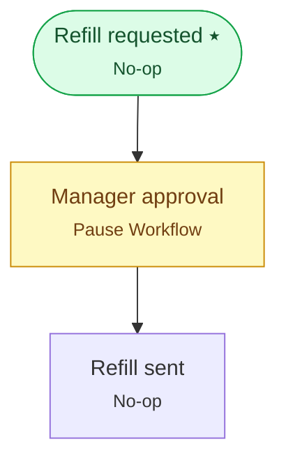

# Example 19 — Approvals: a run that pauses for a person

> **Progressive curriculum · step 19 of 23.** Start a durable background run that stops for a manager's approval, then approve it through the API.

**Concepts introduced here:** PauseWorkflowNodeConfig, background runs, `list_pauses` / `resume(pause_ids=...)`

| | |
|---|---|
| **Workflow name** | Example 19: Approvals with a Pause Workflow node |
| **Builder** | [`wf_example_progression_19.py`](./wf_example_progression_19.py) · `build_assistant_workflow()` |
| **Runnable notebook** | [`notebooks/wf_example_notebooks/wf_example_progression_19.ipynb`](../notebooks/wf_example_notebooks/wf_example_progression_19.ipynb) |
| **Nodes / edges** | 3 nodes, 2 edges |
| **Needs** | A server that enables the Pause Workflow node (`CONTROL_WAIT_NODES_ENABLED`); elsewhere the script says so and stops |

## What it does

A refill request that waits for a manager's approval. The workflow runs as a **durable background run**: no user,
no socket, its state stored while it waits. It stops at a Pause Workflow node until a person approves it, then carries
on to the end. No LLM is called.

## Workflow diagram



*⭑ = start node · solid arrow = direct edge.*

## Nodes

| Node | Type | Role |
|---|---|---|
| Refill requested | No-op | start |
| Manager approval | Pause Workflow | waits up to an hour for a person; reason: "Approve a refill of {{medication}} for {{patient_name}}" |
| Refill sent | No-op | end |

## The flow, step by step

```python
started = await client.workflows.start_background_run(workflow_id, dynamic_variables=DYNAMIC_VARIABLES)
run = await wait_for_status(client, started.workflow_run_id, {"paused"} | FINISHED)   # stops at the approval

pauses = await (await client.runs.list_pauses(run_id, open_only=True)).list_all()
approval = next(p for p in pauses if p.waits_for_person)   # wake["reason"] is what the approver sees

await client.runs.resume(run_id, pause_ids=[approval.pause_id], note="Approved for 30 days",
                         data={"approved": True, "days": 30})
run = await wait_for_status(client, run_id, FINISHED)   # the server resumes it; it completes
```

Approving is not the same as resuming the run: `resume(run_id)` alone lifts a *person's* pause of the run and leaves
the step waiting. Name the step with `pause_ids` (or pass `all_waiting_for_person=True`).

## Key details

- **Only durable runs can wait like this.** A run streamed over a socket can't hold a pause; start it with
  `start_background_run()` (or a schedule).
- **The approver's note and data reach the node**, which writes them to its output variables: `pause_result` (the
  data), `pause_result_note`, `pause_result_resumed_by`, `pause_result_timed_out`.
- **`timeout_seconds` bounds the wait.** Unapproved after an hour, the run carries on with `pause_result_timed_out`
  true.
- **Be told instead of polling:** subscribe a webhook to `workflow_run_paused` (see
  [Webhooks](../docs/guides/webhooks.md)).

## Sample output

```
Uploaded workflow id=6b00…11
Started background run 6b00…18 (started)
Run is paused; waiting on: {'by_wake_kind': {'manual': 1}, ..., 'manual_pauses': [{..., 'reason': 'Approve a refill of lisinopril 10 mg for Ada Lovelace'}]}
Waiting for a person: 'Approve a refill of lisinopril 10 mg for Ada Lovelace' (pause 6b00…19)
Approved: applied; made ready: ['6b00…19']
Run finished: completed
Workflow 6b00…11 deleted.
```

## Run it

```bash
# The notebook (recommended):
pipenv run python notebooks/_run_e2e.py wf_example_progression_19

# Or open the notebook:
#   notebooks/wf_example_notebooks/wf_example_progression_19.ipynb

# Or the script:
pipenv run python wf_examples/wf_example_progression_19.py
```

See [Run control](../docs/guides/run_control.md) for pausing, resuming, signalling and cancelling runs.

---
[← Example 18](./wf_example_progression_18.md) · [Curriculum index](./README.md) · [Example 20 →](./wf_example_progression_20.md)
